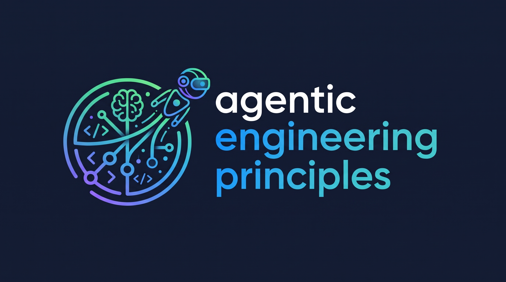

# Agentic Engineering Principles



[](https://github.com/Sarpes/agentic-engineering-principles/actions/workflows/ci.yml)

*Agentic engineering* means building software with an AI coding agent while holding the work to engineering discipline: design first, tests that can fail, independent review, and a human who owns the decisions and can explain the result. *Vibe coding* is the opposite.

Rules, stage gates (the evidence that must exist before work moves to the next stage), templates, a tested documentation gate, and a skill that conducts a project through all of them, for building software with an AI coding agent.

## What this is, and who it is for

It is written for people who build software with an AI coding agent and are not software engineers by training. This page calls that person the **owner**: the person the software is built for, who makes the decisions. The danger for that reader is "vibe coding": accepting whatever the agent produces because it seems to run, and moving so fast that nobody can later explain what was built. This repository answers with a process:

- A project moves through eight stages. Each stage ends at a **gate**: the evidence that must exist before the next stage starts.
- Every rule in `principles/` comes from a lesson in projects built so far. The repository holds 20 principles, each with a real incident behind it. A second layer, `checklist/`, holds engineering practices a newcomer may never have met; each item cites a recognised source (for example OWASP, the Open Worldwide Application Security Project, or NIST, the US National Institute of Standards and Technology).
- A **skill** (a packaged set of instructions an AI coding agent loads for a kind of task) called `agentic-principles` walks the agent through the stages, calls other installed skills at the right moment, and asks for the named evidence before it marks a stage done; the scripts only check that the evidence exists (see Limits).
- Scripts check what can be checked by code: a decision log or a requirements table with a blank field fails the build.

The aim, in the owner's words: every part is tested to its limits, the owner can explain the architecture, each file, the tech stack, how each part was tested and every third-party dependency, without the agent.

## Quick start

1. **Install the plugin once.** In Claude Code:

   ```
   /plugin marketplace add Sarpes/agentic-engineering-principles
   /plugin install agentic-engineering-principles@agentic-engineering-principles
   ```

   Then start a new session; a running session does not pick up a new skill.

2. **Open the agent in your project folder** and say one sentence:

   - New work: *"Start this project under the agentic principles."*
   - Code that already exists: *"Adopt this project under the agentic principles."*

3. **Answer two questions.** The agent recommends a size (Small or Full) and a build method (normal or sub-agent) and explains why; you choose. It then creates the record files and opens Stage 0.

From then on you do not call the skill again: the project's `CLAUDE.md` names it, so every later session in that folder loads it and picks up where the last one stopped. [Using it day to day](#using-it-day-to-day) says what happens in each session.

## The eight stages

| Stage | Gate (evidence needed to move on) | Principles |
|---|---|---|
| 0 Intake | Requirements matrix (`REQUIREMENTS.md`) and attack list (`ATTACKS.md`) exist; facts (dates, quotas, prices) carry their source | [00-intake.md](principles/00-intake.md) |
| 1 Design | Written design approved by the human; decisions logged with rejected options | [01-design.md](principles/01-design.md) |
| 2 Plan | Every task has a definition of done | [02-plan.md](principles/02-plan.md) |
| 3 Build | Each task red-first, green, reviewed by a separate reviewer | [03-build.md](principles/03-build.md) |
| 4 Verify | Real integrations run end to end (the whole program, from input to final result, with the real services); a fresh clone starts with the documented commands | [04-verify.md](principles/04-verify.md) |
| 5 Ship | Secret scan by value; PR shows goal, choices, measurements, how to check | [05-ship.md](principles/05-ship.md) |
| 6 Own | The human can explain every module and has changed at least one by hand | [06-own.md](principles/06-own.md) |
| 7 Retro | Every "where the AI was wrong" entry became a rule, a template change or a recorded "won't fix" | [07-retro.md](principles/07-retro.md) |

The index, with the four-part format of a principle and the kinds of enforcement, is in [principles/README.md](principles/README.md).

## Install and start a project

**As a plugin** (the usual route). In Claude Code, add this repository as a marketplace and install the plugin:

```
/plugin marketplace add Sarpes/agentic-engineering-principles
/plugin install agentic-engineering-principles@agentic-engineering-principles
```

This plugin passes `claude plugin validate .` with warnings and installs from the marketplace with these two commands. Whether an agent loads the skill on its own in a new session is still to be confirmed (see Limits).

The plugin is called `agentic-engineering-principles`; the skill inside it keeps the short name `agentic-principles`, which is the name you will see in a session.

**Clone and link.** Clone the repository, then link the folder `skills/agentic-principles` into your skills folder, so the skill appears as `agentic-principles`:

```
ln -s <clone>/skills/agentic-principles ~/.claude/skills/agentic-principles
mklink /J "%USERPROFILE%\.claude\skills\agentic-principles" "<clone>\skills\agentic-principles"
```

The first line is for macOS and Linux. On Windows, `ln -s` in Git Bash may copy the folder instead of linking it when the account lacks the right to create symbolic links, so Windows users should use the second line. The second line is for the Windows command prompt, where `mklink /J` makes a junction (a folder link). Any folder or link inside `~/.claude/skills` loads as a skill, so keep backups outside it. The skill finds the principles, checklist and templates in the clone; `init_project.py --where` prints where it found them.

**Start a project.** Open the agent in the project folder and ask it to run the project under the agentic principles. It recommends a size and a build method; you choose both:

- **Small**: one script or module, no live users, no personal data, no paid calls. The gate refuses "Small" for a project with a container file, more than 10 tracked source files, or a web, LLM, paid-API or personal-data trait (a *trait* is a property of the project, detected from its files, that brings extra checks with it).
- **Full**: everything else.
- **Build method**: *normal* (one session works through the plan, with one independent review at the end) or *sub-agent* (a sub-agent is a separate AI session given one job: a writer and a separate reviewer per task).

The skill then runs `init_project.py`, which copies the templates and the gate scripts into the project, writes a marked block into the project's `CLAUDE.md` (so the skill is loaded in every later session) and adds the checks to the project's continuous integration (CI: a service that runs the tests and checks automatically on every push). Without the agent, the same checks run as `python checks/check_gates.py` and `python checks/check_docs.py .` (Python 3.11 or newer, standard library only; exit code 0 means no problems, 1 lists them, 2 means the folder cannot be checked, for example because it is not the top of a git repository or is a shallow clone).

An existing project can be adopted at whatever stage it has really reached. Earlier stages are marked `adopted`, which means "not done under this skill", never "passed".

## Using it day to day

### What every session starts with

You open the agent in the project folder; you do not need to ask for anything. Before any work the agent:

1. **Runs the gate check** (`python checks/check_gates.py`) and tells you what it found: problems, overrides still open, whether an ownership re-check is due, and whether your project was set up with an earlier version of the skill. `STAGES.md` records that version in its `Skill-version:` line; when a later release changes the layout, the check lists what to change, one step per note.
2. **Checks the helper skills** (`check_companions.py`) and says out loud which ones the current stage needs and which are missing. A missing one is replaced by a recorded fallback, never skipped silently.
3. **Opens the current stage**: the first one in `STAGES.md` that is not closed. It says in plain words what the stage is for, what evidence will close it, and which overrides are open.

Then the work of that stage happens, and the agent calls the installed skills listed in [Works with these skills](#works-with-these-skills) at the right moment.

### What you can say

| You say | What happens |
|---|---|
| "Start this project under the agentic principles." | Size and method are recommended, you choose, setup runs, Stage 0 opens. |
| "Adopt this project." | You say which stage the work has really reached; earlier stages are marked `adopted`. |
| "Where are we?" or "What is open?" | The gate check runs and the agent reads out the current stage, its missing evidence and the open overrides. |
| "Mark this stage passed." | It is marked `passed` only if the gate check accepts the named evidence. Otherwise the agent says what is missing. |
| "Skip this." | The agent tells you in one or two sentences what would be skipped and what could go wrong, asks why, and writes your own words into `OVERRIDES.md`. |
| "Show me the open overrides." | The list from `OVERRIDES.md`. Before release you re-confirm each one. |
| "We are done; start the next piece of work." | A new cycle: the old `STAGES.md` is archived and a fresh one starts. |

### Where your records live

Setup copies these files into the project. They are plain text, committed with the code, and readable without the agent.

| File | What it holds | Filled at |
|---|---|---|
| `STAGES.md` | Each stage's status (`open`, `passed`, `overridden`, `adopted`) and the evidence that closed it | Every stage |
| `REQUIREMENTS.md` | What the software must do, as `REQ-1`, `REQ-2`, ... | 0 Intake |
| `ATTACKS.md` | How it could be broken or misused, as `ATK-1`, `ATK-2`, ..., drafted by a separate session | 0 Intake |
| `GRILLING.md` | The challenges you were grilled with on the requirements and on the design, your own answers, and what each answer changed. Every project, Small or Full | 0 Intake, 1 Design |
| `DECISIONS.md` | Every non-obvious choice, with the options rejected | From 1 Design on |
| `ARCHITECTURE.md` | The parts and how they connect, a map of every file, the dependencies, and how each part was tested | Grows from 1 Design to 5 Ship |
| `BUILD-LEDGER.md` | What was built task by task, and the reviewer's findings | 3 Build |
| `GO-LIVE.md` | The risks your project's traits bring, each with evidence (Full size only) | 5 Ship |
| `OWNERSHIP.md` | Where your private ownership record is (`Record:`), when the explain-back was done, the commit you changed by hand, and the re-check dates. Never your answers | 5 Ship, 6 Own |
| Private record, outside the project | Your explain-back answers and the closed-book round, in your own words, with the gaps and who graded them. It lives in a private companion repo next to the project (`../<project>-internal/ownership/OWNERSHIP.md`), because the project repo may be public | 5 Ship, 6 Own |
| `OVERRIDES.md` | Every gate you chose to skip: why, and the risk you accepted (Full size; created at the first override on Small) | Any stage |
| `GLOSSARY.md` | Every term explained to you once, so nothing is explained twice | Any stage |

### What the agent will never do for you

The agent never writes what only you can give: your explain-back answers, your answers in the ownership round, an approval, the reason for an override, or a re-confirmation. It offers to ask the questions instead. It also refuses "just mark it passed" when the evidence is missing: you may skip a gate through an override, but nobody can make a missing file exist.

### The ownership re-check

At Stage 6 you explain the project without the agent. A gap you cannot explain keeps the stage open, and a re-check is set within a week. At the next session after that date, the agent does the re-check before any other work.

### Your answers stay private

Your answers show how well you understand your own system, so they never go into the project repository, even a private one: a repository can be made public later, and a commit keeps its history. They go into a private companion repository next to the project, `<project>-internal`, which [repo-kickoff](https://github.com/Sarpes/repo-kickoff) creates (`scaffold_project.py ... --internal-only` adds one to an existing project). The project's `OWNERSHIP.md` names that record in its `Record:` line, and `check_gates.py` reads the answers from there:

- **Fail-closed.** From Stage 5 on, a record that cannot be read fails the gate, reported as "could not be read". A readable record without answers is a different problem, reported by the section it lacks.
- **Answers in the project are refused** at every stage, so one cannot slip in early.
- **CI.** The companion is never checked out in the project's continuous integration, so the workflow runs `check_gates.py --private-unavailable`: only the "could not be read" case becomes a printed `NOT CHECKED` note there. Your local run, without the flag, is the one that checks the answers.

## What a run looks like

At the opening of each stage the agent says in plain words what the stage is for, what evidence will close it, and which overrides (recorded choices to skip a gate) are still open. Then the work happens:

1. **Intake.** You state acceptance criteria (`REQ-1`, `REQ-2`, ...). A separate session plays the attacker and drafts an attack list (`ATK-n`: how could this be broken or misused?); you read it and add to it. Then you are grilled on both, one challenge at a time, on every project.
2. **Design and plan.** Questions come before code. Decisions are logged with the options rejected. The approved design is grilled the same way, on every project. Every task gets a definition of done.
3. **Build.** A failing test comes first, then the code, then an independent review. The suite runs after every merge.
4. **Verify.** Each part climbs the test ladder below. A real end-to-end run (the whole program, from input to final result, with the real services) happens early.
5. **Ship.** Before release you answer, in your own words, what the project does, how it can break and how to recover (the *explain-back*). A go-live review (a list of the risks the project's traits imply, checked before anything goes live) needs evidence on every row.
6. **Own.** Closed-book, you explain the project and change one module by hand; a separate session grades the answers. A gap keeps the stage open, and a re-check follows within a week.
7. **Retro.** Every "where the AI was wrong" entry becomes a rule, a template change or a recorded "won't fix".

A stage is marked `passed` only when `check_gates.py` accepts the evidence it names. You may skip a gate through an **override**: a recorded choice (a way past a gate), with your reason and the risk you accept, kept in `OVERRIDES.md` and re-confirmed before release. The gate script checks that the named evidence exists; the limits below say what it cannot check.

## The test ladder

"Tested to its limits" means each part climbs five rungs. A rung that cannot apply is marked not applicable, with a reason.

1. **Written first.** A test failed before the code existed.
2. **Proven to catch breakage.** Removing the behaviour turns a test red. This is done by mutation testing (a tool that makes small deliberate changes to the code and checks that some test fails) or by hand on a throwaway copy. Green tests alone are not evidence.
3. **Whole input range.** Generated inputs, boundary values and hostile inputs chosen to break it.
4. **Real integration.** A start from a clean clone using only the documented commands, and an end-to-end run with the real services.
5. **Deliberate failure.** Kill a process, break a key, cut the network, feed corrupt data; the system recovers or fails visibly with a reason.

## Limits, stated openly

The scripts and the skill have limits, and a green result must not be read as more than it is.

- **The scripts verify that evidence exists, not that a person really approved or wrote it.** A named file is present, a named commit is real, a table row is filled. The owner and the agent share one git identity, so the scripts cannot tell who approved something. Approvals rest on trust until a tool-call hook (a rule that blocks the agent's action) exists; it is planned for a later version. `check_gates.py` prints this limit on every run.
- **Two things cannot be fully scripted:** proving that a test failed before its code existed, and judging the quality of written prose.
- **The companion report is a hint.** `check_companions.py` reads the plugin cache and can miss skills that live elsewhere; the session's own skill list wins.
- **Mutation testing's tool may be unavailable.** The plugin needs a tool that may not be installed, so rung 2 is usually done by hand on a throwaway copy, and the skill says so.
- **A companion that needs the Workflow tool may not run in every session.** It then counts as missing, and its fallback is used and recorded.
- **Automatic loading is proven only once the skill is installed.** The tests check the skill's files and that its instructions hold under pressure; whether an agent loads it on its own can only be seen in a real installed session.

## Works with these skills

The skill is a conductor: it decides which installed skill runs when, and adds gates, evidence and plain-language guidance around it. It does not copy or restate their instructions; credit for the techniques belongs to their authors. [CREDITS.md](CREDITS.md) names each one's author, source and licence, along with the formats this project follows. Every one is optional. When a plugin is missing or switched off, the skill says so, uses the fallback named in `skills/agentic-principles/companions.json` and records the fact as evidence for that stage; it never silently skips the step.

Install a plugin with `/plugin install <plugin>@<marketplace>`, after adding its marketplace once with `/plugin marketplace add <owner/repo>`. The marketplaces and their sources:

- claude-plugins-official: `anthropics/claude-plugins-official`
- trailofbits (the Trail of Bits skills): `trailofbits/skills`
- karpathy-skills: `forrestchang/andrej-karpathy-skills`
- anthropic-agent-skills: `anthropics/skills`

| Plugin | What it does here | Stage | Marketplace |
|---|---|---|---|
| `repo-kickoff` | Local skill for starting a repository and for auditing that its documents match its code | 0, 5 | Local skill, not from a marketplace |
| `superpowers` | Brainstorming, writing plans, the sub-agent and normal build methods, test-first loop, answering review, verification before claims, finishing a branch | 1 to 5 | claude-plugins-official |
| `mattpocock-skills` | Research, grilling you on the requirements and the design (every project), glossary, module boundaries, prototypes, test placement, hard-bug diagnosis, branch review | 0 to 5 | claude-plugins-official |
| `andrej-karpathy-skills` | Agent habits: state assumptions, keep it simple, change only what is needed | 1 to 3 | karpathy-skills |
| `anthropic-skills` | Deep research across sources, for facts that need primary documents | 0 | Not an installable plugin here; see below |
| `property-based-testing` | Generated inputs over the whole input range (rung 3) | 4 | trailofbits |
| `mutation-testing` | Proves tests catch breakage (rung 2); see the limit above | 4 | trailofbits |
| `pr-review-toolkit` | Agents that hunt silent failures and gaps in tests | 4 | claude-plugins-official |
| `deepeval` | Evaluating the output of a language model, for projects that use one | 4 | claude-plugins-official |
| `example-skills` | Browser-app testing, for projects with a web interface | 4 | anthropic-agent-skills |
| `differential-review` | Security-focused review of what changed | 5 | trailofbits |
| `insecure-defaults` | Finds insecure default settings | 5 | trailofbits |
| `spec-to-code-compliance` | Checks documents against the code | 5 | trailofbits |
| `supply-chain-risk-auditor` | Audits dependencies for supply-chain risk | 5 | trailofbits |
| `audit-context-building` | Prepares the agent to read an existing codebase, for adoption | 6 | trailofbits |
| `claude-md-management` | Updates the agent's project instructions after the retro | 7 | claude-plugins-official |

The plugin `anthropic-skills` is not installable as a plugin here. It is provided with some Claude accounts and may be absent; when it is, the fallback in `companions.json` applies. Built-in commands the skill also uses (running the app, a security review) need no install.

## How it is tested

`python -m unittest -v` runs the tests in [tests/](tests/): the documentation checker, the stage-gate script, the project setup script, the companion mapping, the checklist, the templates, the principles and this README. GitHub Actions runs the tests and then the gate on this repository, on Python 3.11 and 3.13, on Ubuntu, Windows and macOS.

The checks in `tests/` are written with a case that must fire and a look-alike that must not. The gate can fail: `test_cli_exit_1_on_broken_repo` in [tests/test_check_docs.py](tests/test_check_docs.py) builds a broken repository in a temporary directory at run time and expects exit code 1. The pre-commit secret gate in [.githooks/](.githooks/) is tested the same way with a temporary git repository and a key-like line made at run time. A test compares the plugins named in this README with `companions.json`, so the two cannot drift apart. One test that scans for private names is skipped in CI because it needs a local environment variable; this is expected.

## Licence

MIT. © 2026 Sarp Esenyel.
